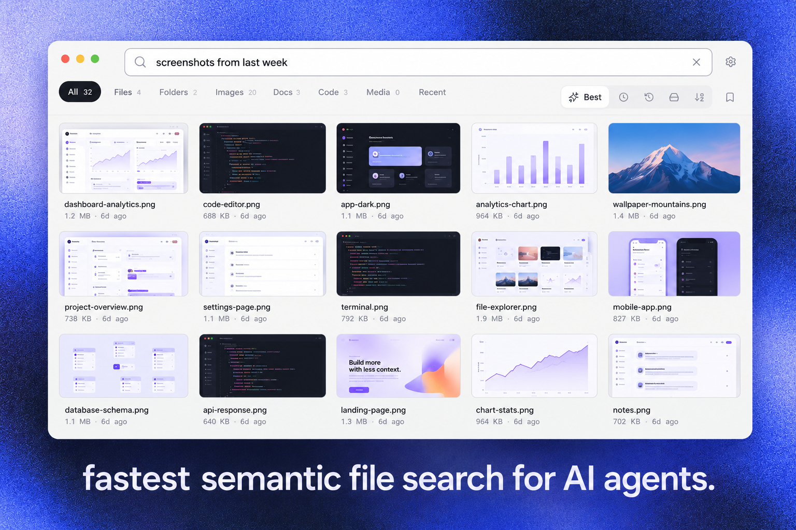

<p align="center">
  
</p>

<h1 align="center">Kensaku <span title="kensaku = search, in Japanese">検索</span></h1>

<p align="center">
  <b>Find anything on your computer, by what it says and what it means.</b>
</p>

<p align="center">
  Local-first search for files, documents, screenshots and code.<br/>
  Your index never leaves your machine, and your AI agents can search it too.
</p>

<p align="center">
  <b>Super fast · Super light · Private by default</b><br/>
  Results in ~3 ms per keystroke · about 73 MB of memory while indexing · nothing leaves your computer.
</p>

<p align="center">
  <a href="https://github.com/yjid/kensaku/releases/latest"></a>
  <a href="LICENSE"></a>
  <a href="https://github.com/yjid/kensaku/actions/workflows/ci.yml"></a>
</p>

<p align="center">
  <a href="#install">Install</a> ·
  <a href="#why-kensaku">Why Kensaku</a> ·
  <a href="#for-ai-agents">For AI agents</a> ·
  <a href="#performance">Performance</a> ·
  <a href="docs/USAGE.md">Docs</a> ·
  <a href="https://github.com/yjid/kensaku/releases">Releases</a>
</p>

<p align="center">
  
</p>

---

## Search your files the way you remember them

You remember the file. Not its name.

It was a PDF about a failed deploy. Or the screenshot of that database error. Or the invoice from March. Your operating system's search wants a filename, and gives up the moment the answer lives inside the file.

Kensaku indexes what is *inside* your files. Type a few words, get the right file in milliseconds. Nothing is uploaded, and no account is needed.

- **Search by meaning.** "That docker build error" finds the log, even when those exact words aren't in it.
- **Search inside.** PDFs, Office files, EPUB, RTF, code, logs, and text in images.
- **Search from anywhere.** The desktop app, a terminal, and your AI agents all query one index.
- **Stay private.** Everything runs on your computer.

## Why Kensaku

### It understands more than filenames

Kensaku blends three signals: exact text matches, fuzzy matches that tolerate typos, and semantic similarity from a small local embedding model. Results are ranked by relevance and recency, so the file you touched last week tends to win. Power users get precise control with a query language (see below).

### It reads what is in your files

- **Documents:** PDF, DOCX, PPTX, XLSX, EPUB, ODT/ODS/ODP, RTF, and plain text.
- **Code and logs:** full-text search across source and config files, including CJK text.
- **Images:** text is read with Tesseract by default. An optional, more accurate PP-OCRv6 engine is available in Settings.
- **Images, beyond text:** thumbnails, dimensions, near-duplicate detection, and screenshot bursts that collapse to one result.

### A calm interface

The 1.0.1 interface is built for everyday use:

- **One search field.** Type and results appear. Only search and Settings are on screen.
- **A grid of square cards.** Thumbnails for images, type icons for everything else, and infinite scroll that renders only what you can see.
- **A quiet hover.** Move across a card to see its size, dimensions, and age.
- **Right-click for more.** Open, show in folder, copy path, or view details.
- **Light and dark themes.** Neutral colors, the system font, and gentle motion.

### It gives the same power to your AI agents

Kensaku exposes its index to AI agents over MCP, so your assistant can find files instead of you pasting paths into chat. The agent surface is read-only by default.

| Tool | What it does |
|---|---|
| `search` | Ranked or exhaustive search with cursor pagination and path, extension, and recency filters |
| `read_snippet` | A bounded excerpt from a file, centered on a query |
| `regex_search` | Bounded regular-expression search over content |
| `find_symbol` | Definitions of functions, classes, and types (Rust, Python, JavaScript, TypeScript) |
| `similar_images` | Visually similar images (when the visual pack is enabled) |
| `index_state` | Freshness, phase, model and size |
| `health_check` | Daemon, database, index and model health |
| `reindex` | Off unless you enable it, and only with the daemon running |

Agents see the same ignore rules you do: `.gitignore` and `.cursorignore` are respected by default. You can limit an agent to specific folders with `agent_scoped_roots`.

One-click setup is in Settings → Agents for Claude Desktop, Claude Code, and Cursor. Other MCP clients can use the JSON snippet shown there.

### It stays on your machine

No telemetry. No account. No hosted search. Your index and settings live in your OS config directory. The only network traffic is a model or OCR download you start yourself.

### It is fast

On a ~100,000-file corpus, a keystroke-level search takes about **2.8 ms** on average. Results appear as you type. See [Performance](#performance) for details.

### A query language, when you want one

For scripts and precise searches:

```
type:pdf invoice          ext:md in:"~/Notes"       modified:7d
size:>10mb                path:"client/2026"        lang:rust
name:resume               content:"timeout"         re:"fn \w+_test"
-draft                    mode:exhaustive
```

Full reference: [docs/USAGE.md](docs/USAGE.md).

## Install

Download the bundle for your system from the [latest release](https://github.com/yjid/kensaku/releases/latest).

| Platform | Download |
|---|---|
| macOS (Apple silicon and Intel) | `Kensaku_<version>_universal.dmg` |
| Windows | `Kensaku_<version>_x64-setup.exe` or `.msi` |
| Linux | `.AppImage`, `.deb`, or `.rpm` |

Builds are not yet code-signed, so macOS and Windows show a warning the first time. That is expected for an independent app, not a sign of a problem.

- **macOS:** open the app, then go to System Settings → Privacy & Security and click **Open Anyway**.
- **Windows:** on the SmartScreen prompt, click **More info** → **Run anyway**.

[docs/INSTALL.md](docs/INSTALL.md) has the full steps.

**First run:** choose the folders you want indexed, pick exclusions, and optionally download the OCR or model packs. Search works while the first scan runs.

**Command line:** `kensaku-cli` ships with each release.

```bash
kensaku-cli search "docker error"
kensaku-cli search "invoice" --ext pdf --since 30d
kensaku-cli search "resume" --json
kensaku-cli state
```

### Build from source

```bash
git clone https://github.com/yjid/kensaku
cd kensaku
bun install
bun run tauri build
```

You need Rust (stable), Bun 1.1 or later, and your platform's webview libraries. See [docs/INSTALL.md](docs/INSTALL.md). A `Makefile` covers the common tasks: `make dev`, `make build`, `make test`, and `make reset`.

## For AI agents

Point an MCP client at the CLI:

```json
{
  "mcpServers": {
    "kensaku": { "command": "kensaku-cli", "args": ["mcp"] }
  }
}
```

For clients that connect over HTTP, run `kensaku-cli serve`. It listens on loopback only and requires a bearer token stored in your config directory.

Responses are budgeted in size, and file content is returned as data, never as instructions. Full guide: [docs/AGENTS.md](docs/AGENTS.md).

## Performance

Measured on a release build, Linux, local SSD, warm cache, with a ~100,000-file synthetic corpus and default exclusions:

| What | Result |
|---|---|
| Walk the tree | ~190 ms per 100k files |
| Filename search, keystroke path | ~2.8 ms average (p50) |
| Index memory per entry | ~128 bytes (~12.8 MB per 100k files) |

Indexing is a single pass: each file is read once and feeds both the text and meaning indexes. Images are read once for OCR. Work is queued in bounded batches, so memory stays flat on large folders.

Results are reference values, not guarantees. Full methodology and the benchmark harnesses are in [docs/BENCHMARKS.md](docs/BENCHMARKS.md).

## Privacy and security

- **Local by default.** No telemetry, no account, no cloud search.
- **You choose what is indexed.** Watched folders and exclusions are yours. Hidden files and common build folders are skipped by default, and credential files such as `.pem`, `.key`, and `.pfx` are excluded.
- **Bounded processing.** Each file has a time limit and a size limit, so one bad file can't stall the index.
- **Read-only agent access.** The agent tools cannot change files. `reindex` is off unless you enable it.
- **Treat the index as sensitive.** It contains file names and extracted text. Don't sync it to a shared location.

Full threat model: [SECURITY.md](SECURITY.md).

## Status

**Available now**

- Desktop app with the 1.0.1 interface: light and dark themes, grid results, infinite scroll, thumbnails (with a setting), hover details, and right-click actions
- Search by name, content, meaning, and typo-tolerant matches
- Documents, code, and images (with OCR), CJK-aware
- Incremental indexing that tracks renames and deletes
- Agent access over MCP and loopback HTTP, with one-click setup for Claude and Cursor
- Optional local model for query refinement and cited answers (`/ask`)
- `.gitignore` and `.cursorignore` respected by default

**Known limitations**

- Builds are not yet code-signed, and the auto-updater is not wired up yet.
- Native platform OCR is not implemented. Tesseract and the optional PP-OCRv6 pack are the engines.
- Thumbnails cover image files only. Documents and code show type icons.
- Visual search is a beta model download and is not part of search results yet.

## Contributing

- [Contributing guide](docs/CONTRIBUTING.md)
- [Security policy](SECURITY.md): please report vulnerabilities privately
- [Issues](https://github.com/yjid/kensaku/issues)
- [MIT license](LICENSE)

Useful contributions: bug reports with steps to reproduce, testing on each platform's install path, search-quality improvements, agent integrations, and documentation.
