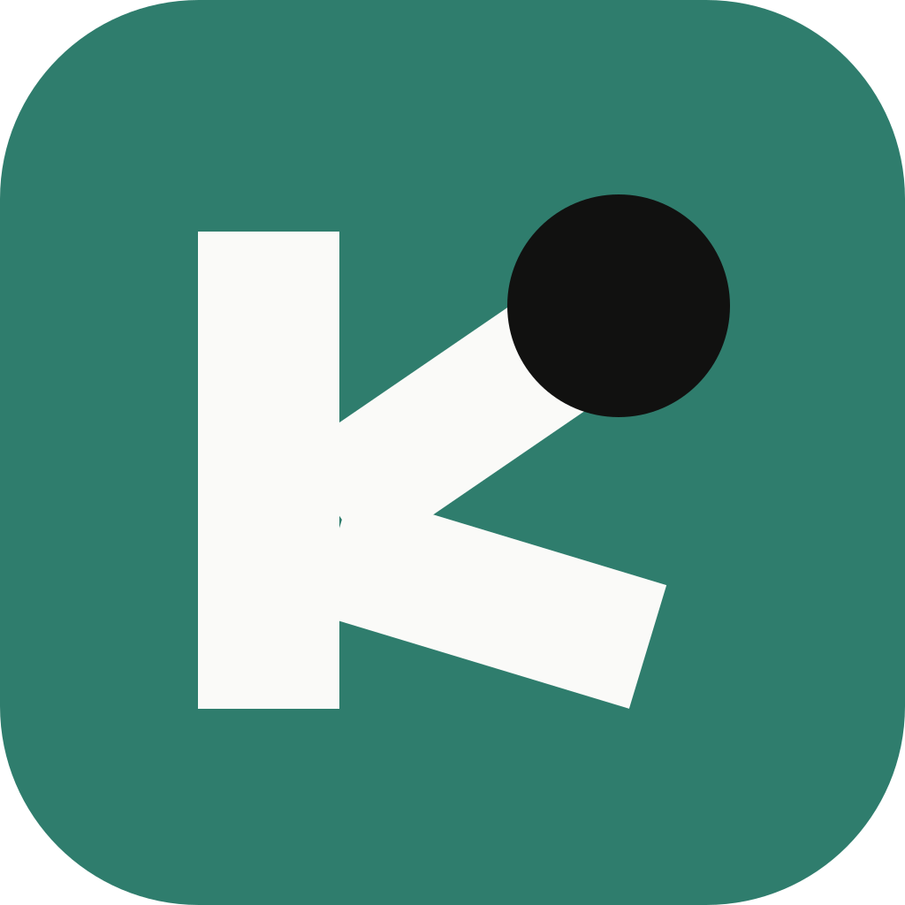
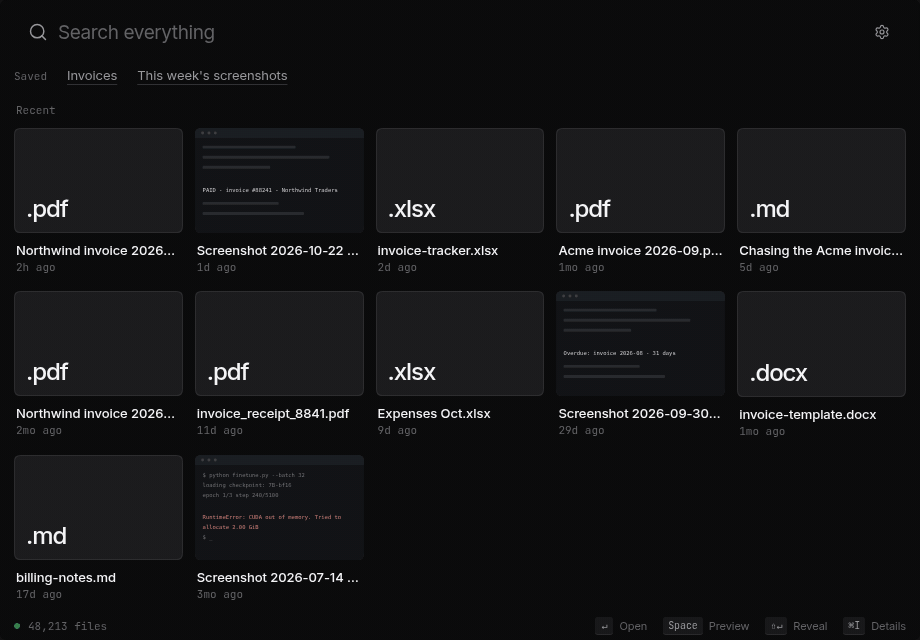
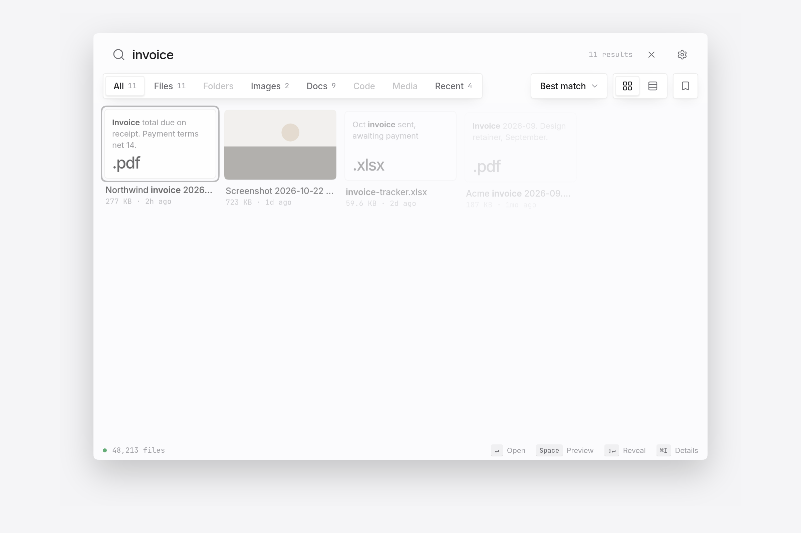

<p align="center">
  
</p>

<h1 align="center">Kensaku <span title="kensaku = search, in Japanese">検索</span></h1>

<p align="center">
  <b>Fast, light, and efficient. Find anything on your computer.</b>
</p>

<p align="center">
  Search 100,000 file names in about a millisecond, using roughly 12 MB of memory.<br/>
  Search inside documents, images, and code too. Nothing leaves your machine.
</p>

<p align="center">
  <a href="https://github.com/yjid/kensaku/releases/latest"></a>
  <a href="https://github.com/yjid/kensaku/releases/latest"></a>
  <a href="LICENSE"></a>
  <a href="https://github.com/yjid/kensaku/actions/workflows/ci.yml"></a>
</p>

<p align="center">
  <a href="#install">Install</a> ·
  <a href="#what-kensaku-does-that-the-others-dont">Why Kensaku</a> ·
  <a href="#features">Features</a> ·
  <a href="#performance">Performance</a> ·
  <a href="#connect-ai-agents-mcp">MCP</a> ·
  <a href="docs/USAGE.md">Docs</a> ·
  <a href="#contributing">Contribute</a>
</p>

<p align="center">
  
</p>

<p align="center">
  <sub>Searching for text that only exists inside a screenshot. 10 seconds, no cuts.</sub>
</p>

---

## Find it the way you remember it

You don't remember the filename. You remember what was in it.

- The PDF about database indexing, saved as `notes-final-2.pdf`.
- The log line from the failed deploy, somewhere in a folder of logs.
- The screenshot with a CUDA error, which has no useful name at all.

Type what you remember. Kensaku searches names, text inside files, and meaning, and shows the match with the words highlighted. Open it with Enter.

## What Kensaku does that the others don't

Filename tools are everywhere. Reading *inside* your files — locally, instantly, and for free — is not.

| | Kensaku | Everything | Listary | PowerToys Run |
|---|---|---|---|---|
| Filename search, milliseconds | ✅ | ✅ | ✅ | ✅ |
| Full text inside PDF/DOCX/EPUB… | ✅ | ❌ | ❌ | ❌ |
| Text inside screenshots & images (OCR) | ✅ | ❌ | ❌ | ❌ |
| Find by meaning ("the PDF about indexing") | ✅ | ❌ | ❌ | ❌ |
| Natural-language time ("screenshots from last week") | ✅ | ❌ | partial | ❌ |
| Your AI agents can search it (MCP) | ✅ | ❌ | ❌ | ❌ |
| Launcher behavior (summon, type, Enter) | ✅ | ❌ | ✅ | ✅ |
| Open source (MIT) | ✅ | ❌ | ❌ | ✅ |

*Spotlight and Raycast are excellent but macOS-only; Alfred's content search and AI are paid tiers. Kensaku is one app, three platforms, free and MIT-licensed.*

**Three things worth trying on day one:**

1. **Screenshot archaeology.** You know you saw that error in a screenshot. Kensaku read the pixels — search the error text.
2. **Describe, don't recall.** "big videos from last month" is a valid query. No filters to click.
3. **Give your AI agent eyes.** Claude or Cursor can search this same index over MCP — read-only, local, no cloud.

## Features

**Fast**
- Filename search across ~100,000 files in a few milliseconds on a warm cache. Method and numbers are in [Performance](#performance).
- Results update as you type. There is no separate search page.
- Incremental indexing: changed files are picked up without rescanning the whole disk.

**Finds more**
- Names, full text, fuzzy matches that tolerate typos, and meaning, in one search.
- Documents: PDF, DOCX, PPTX, XLSX, EPUB, ODT/ODS/ODP, RTF, plain text, code, and logs, including CJK text.
- Images: text is read with PP-OCRv6 by default (no system install needed). An optional
  higher-quality Indra engine (deskew, multi-script recognition, ~27 MB pack downloaded on
  demand) and classic Tesseract are both selectable in Setup/Settings.

**Precise**
- Filters and sort: Best match, Newest, Oldest, Largest, Name.
- Time travel: "last Tuesday", "3 days ago", "last week", "today", "yesterday".
- A query language when you want it (below).

**A real launcher**
- Starts hidden in the tray and summons with a keystroke. Recents are ranked by what you actually opened, and they survive restarts.
- Space previews (Quick Look) for PDFs, images, and text. Grid or list layout. Full keyboard navigation.

**Works with AI agents**
- Compatible agents can search the same local index over MCP. Read-only by default. See [Connect AI agents](#connect-ai-agents-mcp).

**Private**
- No account, no telemetry, no cloud search. Your index stays in your OS config directory.

**Pleasant to use**
- Light and dark themes. Continuous-corner cards, a borderless search field, and hover details — a calm, native-feeling interface.
- Right-click for open, show in folder, copy path, and details.

<p align="center">
  
</p>

### The query language

For scripts and precise searches:

```
type:pdf invoice          ext:md in:"~/Notes"       modified:7d
size:>10mb                path:"client/2026"        lang:rust
name:resume               content:"timeout"         re:"fn \w+_test"
-draft                    mode:exhaustive
```

Full reference: [docs/USAGE.md](docs/USAGE.md).

## Install

Download the bundle for your system from the [latest release](https://github.com/yjid/kensaku/releases/latest).

| Platform | Download |
|---|---|
| Windows | `Kensaku_<version>_x64-setup.exe` or `.msi` |
| macOS (Apple silicon and Intel) | `Kensaku_<version>_universal.dmg` |
| Linux | `.AppImage`, `.deb`, or `.rpm` |

Every release also ships `kensaku-cli` for the command line and a `SHA256SUMS` file so you can verify what you downloaded.

Builds are not yet code-signed, so macOS and Windows show a warning the first time. That is expected for an independent app, not a sign of a problem.

- **Windows:** on the SmartScreen prompt, click **More info** → **Run anyway**.
- **macOS:** open the app, then go to System Settings → Privacy & Security and click **Open Anyway**.

[docs/INSTALL.md](docs/INSTALL.md) has the full steps.

**First run:** choose the folders you want indexed, pick exclusions, and optionally download the OCR or model packs. Search works while the first scan runs.

**Command line:** `kensaku-cli` ships with each release.

```bash
kensaku-cli search "docker error"
kensaku-cli search "invoice" --ext pdf --since 30d
kensaku-cli search "resume" --json
kensaku-cli state
```

### Build from source

```bash
git clone https://github.com/yjid/kensaku
cd kensaku
bun install
bun run tauri build
```

You need Rust (stable), Bun 1.1 or later, and your platform's webview libraries. See [docs/INSTALL.md](docs/INSTALL.md). A `Makefile` covers the common tasks: `make dev`, `make build`, `make test`, and `make reset`.

## Connect AI agents (MCP)

Point an MCP client at the CLI:

```json
{
  "mcpServers": {
    "kensaku": { "command": "kensaku-cli", "args": ["mcp"] }
  }
}
```

For clients that connect over HTTP, run `kensaku-cli serve`. It listens on loopback only and requires a bearer token stored in your config directory.

Responses are budgeted in size, and file content is returned as data, never as instructions. Full guide: [docs/AGENTS.md](docs/AGENTS.md).

## Performance

Speed is the point of Kensaku. Every number below was measured on a release build on Linux (8 vCPU, SSD) against a 100,000-file folder, and the harnesses are in [docs/BENCHMARKS.md](docs/BENCHMARKS.md).

| What | Result |
|---|---|
| Name search, in memory (avg of 8 queries) | **1.3 ms** (best 0.5 ms, worst 2.4 ms) |
| Index 101,101 files, first run | 184 s, peak 183 MB |
| Re-index with nothing changed | **0.56 s** |
| Memory for file names and metadata, 100k files | ~12 MB |

Same folder, same machine, filename search, cold process each run:

| Tool | "invoice" | "deploy_error" |
|---|---|---|
| Kensaku (in memory, no start-up) | 1.3 ms avg | 1.3 ms avg |
| plocate | 34 ms | 6 ms |
| fd | 109 ms | 98 ms |

The two rows aren't a perfect match: Kensaku's search is fuzzy and runs inside a running app, while plocate and fd start a new program for each search. Spotlight, Everything, and Listary haven't been measured yet, and these numbers come from Linux, not macOS or Windows.

**On Windows (1.0.6, release build, Windows 11):** the installer is **9 MB**, and with a 24,500-file index loaded the app idles in the tray at **about 20 MB of private memory** — roughly 150 MB while you're actively browsing results. It trims back down the moment you hide it.

Indexing is a single pass: each file is read once and feeds both the name and text indexes. Work is queued in bounded batches, so memory stays flat on large folders.

## Privacy and security

- **Local by default.** No telemetry, no account, no cloud search. Zero bytes leave your machine.
- **You choose what is indexed.** Watched folders and exclusions are yours. Hidden files and common build folders are skipped by default, and credential files such as `.pem`, `.key`, and `.pfx` are excluded.
- **Bounded processing.** Each file has a time limit and a size limit, so one bad file can't stall the index.
- **Read-only agent access.** The agent tools cannot change files. `reindex` is off unless you enable it.
- **Treat the index as sensitive.** It contains file names and extracted text. Don't sync it to a shared location.

Full threat model: [SECURITY.md](SECURITY.md).

## Status

**Shipping now (1.0.6)**

- Desktop app for Windows, macOS, and Linux: light and dark themes, grid and list results, infinite scroll, thumbnails, hover details, right-click actions
- True launcher behavior: hidden-to-tray start, global summon keystroke, memory trimmed while hidden
- Recents ranked by what you actually opened, persisted across restarts
- Search by name, content, meaning, and typo-tolerant matches
- Documents, code, and images (with OCR), CJK-aware
- Incremental indexing that tracks renames and deletes
- Agent access over MCP and loopback HTTP, with one-click setup for Claude and Cursor
- `.gitignore` and `.cursorignore` respected by default

**Known limitations**

- Builds are not yet code-signed, and the auto-updater is not wired up yet.
- OCR: PP-OCRv6 by default (bundled runtime, ~6 MB model pack downloaded on first run); optional Indra engine with
  deskew and multi-script recognition (~27 MB pack, downloaded on demand). Intel Macs fall back to Tesseract.
  JPEG 2000, fax and JBIG2 scans are not decoded yet.
- Thumbnails cover image files only. Documents and code show type icons.
- Visual search is a beta model download and is not part of search results yet.
- Windows gets the most real-world testing today. macOS and Linux builds ship from CI and would benefit from more hands on them — see below.

## What might come next

Kensaku is actively built, and the roadmap bends toward what people ask for. Some directions being explored:

- **A glass theme — and more customization.** A translucent, vibrancy-style finish, with adjustable density, accents, and per-surface control. The current light/dark pair is the floor, not the ceiling. → [vote & discuss](https://github.com/yjid/kensaku/discussions/36)
- **App search and launch.** Type "term", open Terminal. Installed applications join the same instant index, so the launcher stops where your files end and your tools begin. → [vote & discuss](https://github.com/yjid/kensaku/discussions/37)
- **Internet quick search.** For the things your files can't answer — opt-in, off by default, clearly separated from local results so the local-first promise stays intact. → [vote & discuss](https://github.com/yjid/kensaku/discussions/38)
- **Ask your files questions.** An answers layer on top of the index: "what was the design retainer?" answered from your own documents. Local-first by default, cloud models only if you opt in with a key. → [vote & discuss](https://github.com/yjid/kensaku/discussions/39)
- **Auto-updater & in-app updates.** A "check for updates" button is in the app now; a signed auto-updater is the real answer and needs signing + infra first. → [vote & discuss](https://github.com/yjid/kensaku/discussions/40)

None of this ships on a promise — it ships in the order the community pushes. **You tell us:** open a [discussion](https://github.com/yjid/kensaku/discussions) with your use case, or upvote an existing idea in the [issue tracker](https://github.com/yjid/kensaku/issues). The loudest real-world need gets the next slot.

## Contributing

Kensaku is young, MIT-licensed, and built by people who wanted a better launcher. Every kind of help moves it forward:

- **Use it and break it.** Bug reports with steps to reproduce are the single most valuable contribution right now — especially from macOS and Linux users.
- **Shape the roadmap.** Feature ideas land in [Discussions](https://github.com/yjid/kensaku/discussions); the ones with real use cases behind them get built first.
- **Good first issues.** Check the [issue tracker](https://github.com/yjid/kensaku/issues) for tasks scoped for a first contribution.
- **Search quality.** Ranking, typo tolerance, and new extractors ([docs/EXTRACTORS.md](docs/EXTRACTORS.md) shows how to add one).
- **Agents and integrations.** MCP tooling and guides ([docs/AGENTS.md](docs/AGENTS.md)).
- **Docs, translations, and screenshots.** [docs/CONTRIBUTING.md](docs/CONTRIBUTING.md) has the setup: `bun install`, `make dev`, `make test` (240+ Rust tests run on every push).
- **Security.** Please report vulnerabilities privately via [SECURITY.md](SECURITY.md).

If Kensaku saves you ten minutes, [star the repository](https://github.com/yjid/kensaku/stargazers) — it's the only marketing an independent app has, and it's how the next contributor finds us.
