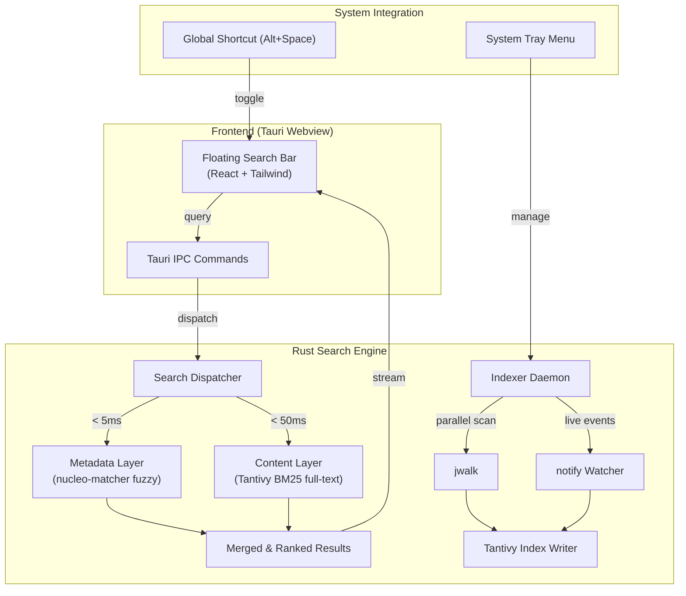

# 🔍 Kensaku (検索)

<p align="center">
  <b>Your computer's search is broken. This isn't.</b><br>
  <i>A blazing-fast, floating local file and full-text content search engine built with Rust + Tauri.</i>
</p>

<p align="center">
  
  
  
  
</p>

---

## ⚡ Why Kensaku?

You know that feeling: you downloaded or wrote a file two weeks ago. You need it *right now*.
- **OS Search (Windows / macOS / Linux)** takes forever, misses results, hogs your CPU, or completely ignores file contents.
- **grep / find** requires opening a terminal, remembering syntax, and waiting minutes across large directories.

**Kensaku solves this in one keystroke.**

Press <kbd>Alt</kbd> + <kbd>Space</kbd> anywhere on your system. A sleek, centered spotlight bar appears. Type anything — a filename or a phrase *inside* any code file or document. **Results appear live in under 10 milliseconds.**

---

## ✨ Features

- ⚡ **Two-Layer Hybrid Search**:
  - **Metadata Layer**: In-memory filename fuzzy matching powered by `nucleo` (**< 5ms**).
  - **Content Layer**: Full-text BM25 index powered by `tantivy` (**< 50ms**) searching text *inside* code, markdown, configs, and text files.
- ⌨️ **Keyboard-First Experience**:
  - `↑` `↓` to navigate results
  - `Enter` to open file with default app
  - `Shift` + `Enter` to reveal containing folder
  - `Esc` to instantly dismiss
- 🎯 **Smart Relevance Ranking**:
  - Match quality bonus (filename matches weighted 2x)
  - Recency boost for files edited recently
  - Path depth penalty (shallow, relevant files rank higher)
- ⚙️ **Onboarding Wizard**:
  - Pick folders to watch (Home, Projects, Documents, etc.)
  - Auto-skips heavy junk: `node_modules`, `.git`, `target`, `.cache`, `venv`, etc.
  - Customize your global shortcut
- 🪶 **Whisper-Quiet Daemon**:
  - Sits in your system tray
  - Incremental updates with `notify` filesystem watcher (no CPU thrashing)
  - Preloaded index: zero startup lag when you hit the shortcut
- 🔒 **100% Offline & Private**: Zero analytics, zero cloud, zero telemetry.

---

## 🏗️ Architecture



---

## 🚀 Quick Start

### Prerequisites
- [Rust](https://www.rust-lang.org/) (edition 2024 / 1.77+)
- [Bun](https://bun.sh/) or [Node.js](https://nodejs.org/)

### Clone and Run

```bash
git clone https://github.com/yjid/kensaku.git
cd kensaku

# Install frontend dependencies
bun install

# Run in development mode
bun run tauri dev
```

### Build Production Release

```bash
bun run tauri build
```

Binary will be produced at `src-tauri/target/release/kensaku`.

---

## 📂 Supported Content Search File Types

Kensaku indexes text and code inside:
- **Code**: `.rs`, `.ts`, `.tsx`, `.js`, `.jsx`, `.py`, `.go`, `.c`, `.cpp`, `.h`, `.java`, `.kt`, `.swift`, `.rb`, `.php`, `.lua`, `.sh`
- **Markup & Docs**: `.md`, `.txt`, `.html`, `.css`, `.scss`, `.tex`
- **Config & Data**: `.json`, `.toml`, `.yaml`, `.yml`, `.xml`, `.csv`, `.sql`, `.ini`, `.env`
- **Build files**: `Dockerfile`, `Makefile`, `Cargo.toml`, `package.json`, `.gitignore`

---

## 🛠️ Configuration

Configuration is stored in `~/.config/kensaku/config.json`. You can edit it through the built-in UI settings dialog (click the gear icon or press Settings) or directly in JSON:

```json
{
  "watched_dirs": ["/home/user/Projects", "/home/user/Documents"],
  "excluded_dirs": ["node_modules", ".git", "target", ".cache", "venv"],
  "shortcut": "Alt+Space",
  "max_results": 50
}
```

---

## 🤝 Contributing

Contributions, feature requests, and bug reports are warmly welcome! Feel free to check the [issues page](https://github.com/yjid/kensaku/issues).

1. Fork the Project
2. Create your Feature Branch (`git checkout -b feature/AmazingFeature`)
3. Commit your Changes (`git commit -m 'Add some AmazingFeature'`)
4. Push to the Branch (`git push origin feature/AmazingFeature`)
5. Open a Pull Request

---

## 📄 License

Distributed under the MIT License. See `LICENSE` for more information.

<p align="center">
  Crafted with ❤️ by <a href="https://github.com/yjid">yjid (Yash Jangid)</a>
</p>
