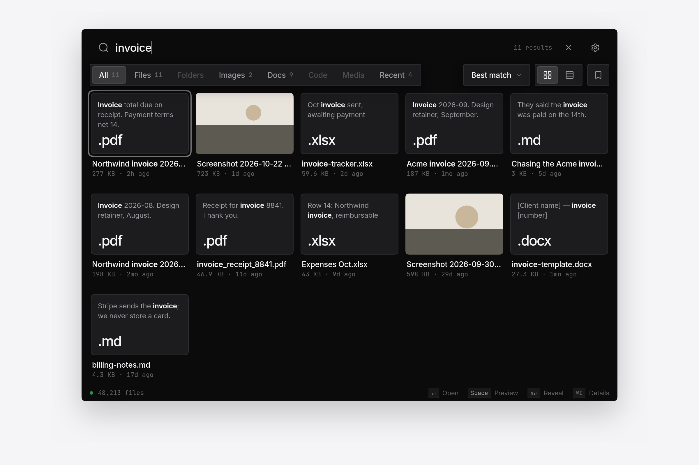
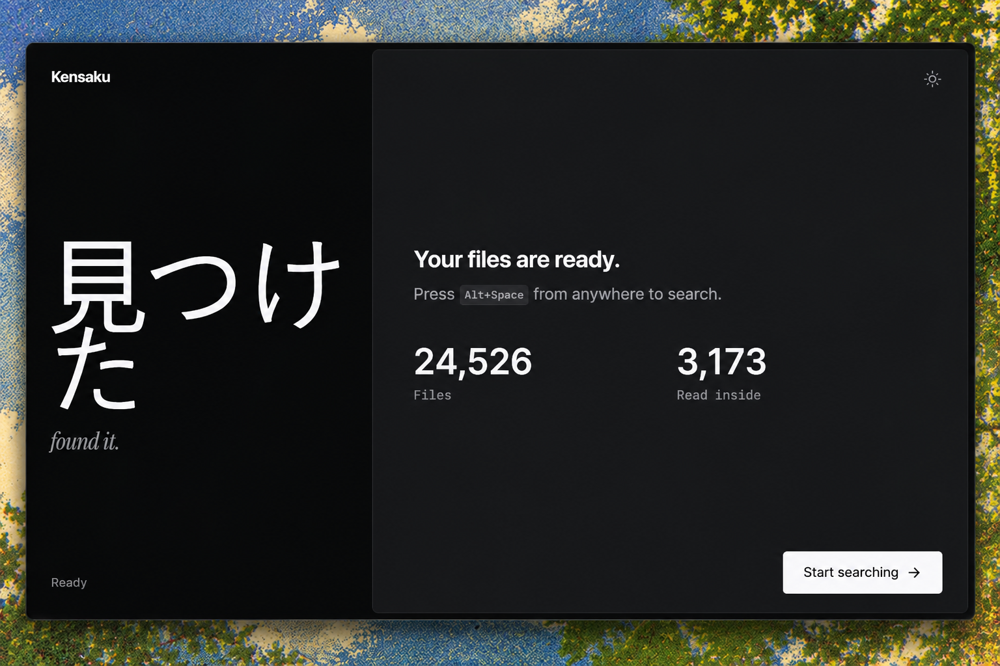

<p align="center">
  
</p>

<h1 align="center">Kensaku <span title="kensaku = search, in Japanese">検索</span></h1>

<p align="center">
  <b>You can't Ctrl+F a screenshot. Now you can.</b>
</p>

<p align="center">
  <a href="https://github.com/yjid/kensaku/releases/latest"></a>
  <a href="https://github.com/yjid/kensaku/releases/latest"></a>
  <a href="LICENSE"></a>
  <a href="https://github.com/yjid/kensaku/actions/workflows/ci.yml"></a>
</p>

<p align="center">
  <a href="#install">Install</a> ·
  <a href="#what-it-does">What it does</a> ·
  <a href="#performance">Performance</a> ·
  <a href="#contributing">Contribute</a>
</p>

<p align="center">
  
</p>

---

Kensaku (検索 = search) is a file search that reads inside your files. PDFs, DOCX, code, logs, screenshots. All local. No cloud. No account. No telemetry. Free. MIT. Don't like it? Fork it.

## What it does

- Reads text inside screenshots (OCR, built in)
- Finds files by meaning, not just names — "the PDF about database indexing" finds `notes-final-2.pdf`
- Parses "screenshots from last week" as a query
- Your AI agent can search it (MCP, read-only)
- 1.3ms name search across 100k files. 9MB installer. ~20MB idle in tray.

## Install

Download from the [latest release](https://github.com/yjid/kensaku/releases/latest).

| Platform | Download |
|---|---|
| Windows | `Kensaku_<version>_x64-setup.exe` or `.msi` |
| macOS | `Kensaku_<version>_universal.dmg` |
| Linux | `.AppImage`, `.deb`, or `.rpm` |

Unsigned builds, so: Windows → SmartScreen → More info → Run anyway. macOS → System Settings → Privacy & Security → Open Anyway. [docs/INSTALL.md](docs/INSTALL.md) has the full steps.

First run: pick folders to index, set exclusions, optionally download OCR/model packs. Search works while the first scan runs.

```bash
kensaku-cli search "docker error"
kensaku-cli search "invoice" --ext pdf --since 30d
kensaku-cli search "resume" --json
```

### Build from source

```bash
git clone https://github.com/yjid/kensaku
cd kensaku
bun install
bun run tauri build
```

Rust (stable), Bun 1.1+, webview libs. `make dev`, `make build`, `make test`, `make reset`.

## Search

Names, full text, fuzzy (typo-tolerant), and meaning — one search. PDF, DOCX, PPTX, XLSX, EPUB, ODT/ODS/ODP, RTF, text, code, logs, CJK. OCR for images.

Query language when you want precision:

```
type:pdf invoice          ext:md in:"~/Notes"       modified:7d
size:>10mb                path:"client/2026"        lang:rust
name:resume               content:"timeout"         re:"fn \w+_test"
-draft                    mode:exhaustive
```

Filters: Best match, Newest, Oldest, Largest, Name. Time travel: "last Tuesday", "3 days ago", "today", "yesterday".

## Performance

| What | Result |
|---|---|
| Name search, 100k files | **1.3 ms** avg (0.5 best, 2.4 worst) |
| Re-index, nothing changed | **0.56 s** |
| Memory, 100k file names | ~12 MB |
| Windows installer | 9 MB |
| Idle in tray (24.5k index) | ~20 MB private |

Methodology + harnesses: [docs/BENCHMARKS.md](docs/BENCHMARKS.md). Numbers are Linux; Windows/macOS not yet measured separately.

## Privacy

No telemetry. No account. No cloud search. Index stays in your OS config dir. You pick what's indexed. Hidden files and build folders skipped by default. `.pem`, `.key`, `.pfx` excluded. Credential files never indexed.

## MCP (AI agents)

Point an MCP client at the CLI:

```json
{ "mcpServers": { "kensaku": { "command": "kensaku-cli", "args": ["mcp"] } } }
```

Read-only by default. Loopback HTTP via `kensaku-cli serve`. Responses budgeted in size; content returned as data, never instructions. [docs/AGENTS.md](docs/AGENTS.md).

## Limitations (I know, I know)

- Unsigned builds. Auto-updater not wired (button in Settings → About opens the release page).
- OCR: Tesseract (default) + optional PP-OCRv6 pack.
- Thumbnails: images only.
- Visual search: beta, not in results yet.
- Windows is the most-tested platform. macOS/Linux come from CI and need real-world testing.

## Contributing

MIT. Bug reports with steps to reproduce are the most useful thing right now. Good first issues labeled. Extractors and agent tooling are where PRs land fastest. [docs/CONTRIBUTING.md](docs/CONTRIBUTING.md). `make dev`, `make build`, `make test` (240+ Rust tests on every push).

Feature ideas go in [Discussions](https://github.com/yjid/kensaku/discussions). Loudest real use case gets the next slot.

<p align="center">
  
</p>