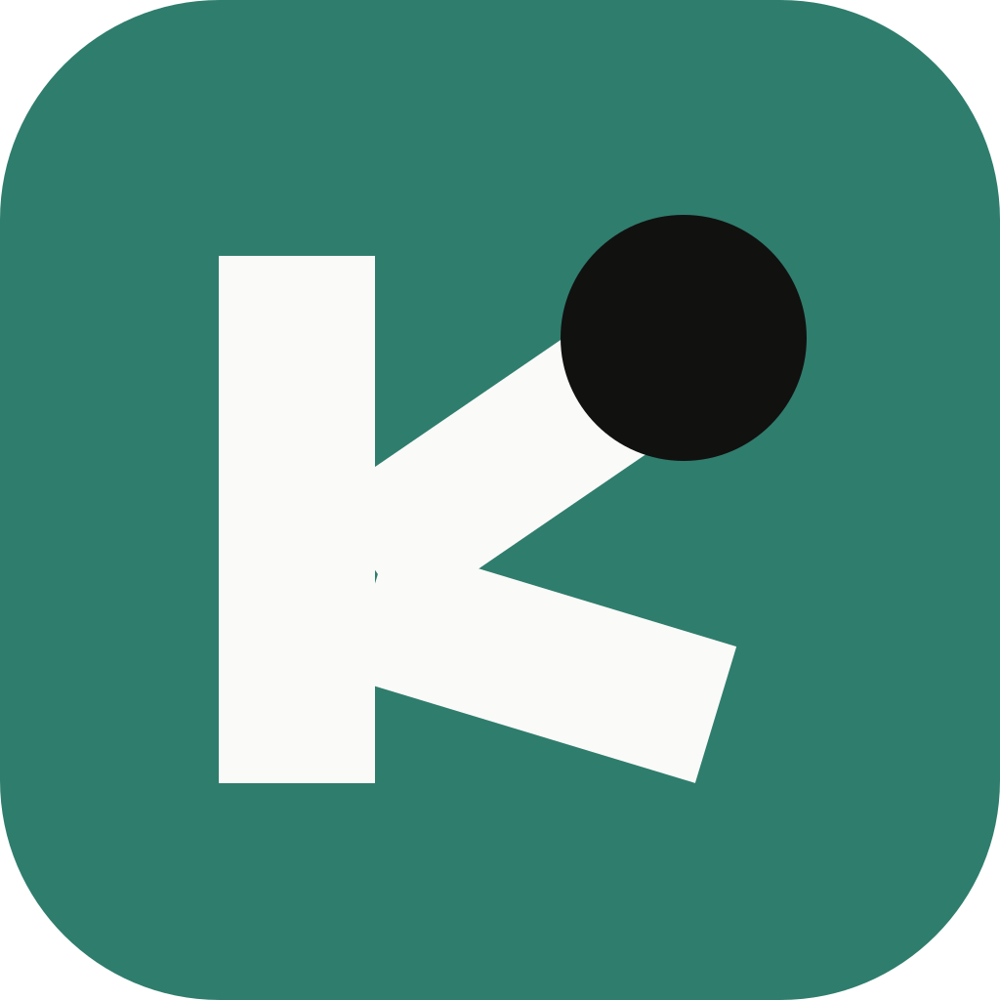
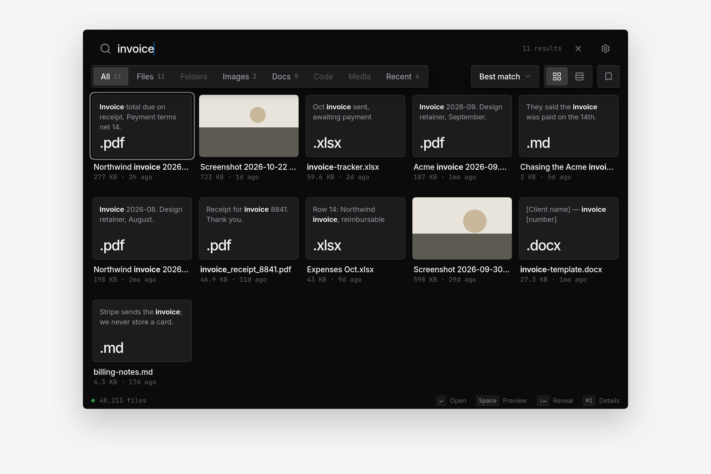

<p align="center">
  
</p>

<h1 align="center">Kensaku <span title="kensaku = search, in Japanese">検索</span></h1>

<p align="center">
  <b>Find anything on your computer.</b><br/>
  File names, the text inside documents, screenshots, and meaning — all offline.
</p>

<p align="center">
  <a href="https://github.com/yjid/kensaku/releases/latest"></a>
  <a href="https://github.com/yjid/kensaku/releases/latest"></a>
  <a href="LICENSE"></a>
  <a href="https://github.com/yjid/kensaku/actions/workflows/ci.yml"></a>
</p>

<p align="center">
  <a href="#install">Install</a> ·
  <a href="#what-it-does">What it does</a> ·
  <a href="#for-ai-agents">Agents</a> ·
  <a href="docs/README.md">Docs</a> ·
  <a href="#contributing">Contribute</a>
</p>

<p align="center">
  
</p>

> **New in 1.0.19:** signed in-app updates, one-line installers, and OCR repair.
> [Release notes](https://github.com/yjid/kensaku/releases/latest)

## Install

**Download for [Windows](https://github.com/yjid/kensaku/releases/latest) ·
[macOS](https://github.com/yjid/kensaku/releases/latest) ·
[Linux](https://github.com/yjid/kensaku/releases/latest)**

1. Download the installer for your computer.
2. Run it and open Kensaku.
3. Pick the folders you want searchable. Search works while the first scan runs.

### Which file do I need?

| Your computer | Download |
|---|---|
| Windows 10/11 (Intel/AMD) | `kensaku_<version>_x64-setup.exe` |
| Windows on ARM (Snapdragon) | `kensaku_<version>_arm64-setup.exe` |
| macOS (Apple silicon or Intel) | `kensaku_<version>_universal.dmg` |
| Linux | `kensaku_<version>_amd64.AppImage` (or `.deb` / `.rpm`) |
| Portable / no installer | Windows `.zip`, Linux `.AppImage`, macOS `.dmg` |

**Windows:** per-user install, no admin prompt. The installer is
Authenticode-signed. A brand-new release can still show a SmartScreen reputation
warning; choose **More info → Run anyway** only if you downloaded it from this
repository's Releases page.

**macOS:** builds are not notarized yet. If macOS blocks the first launch, open
**System Settings → Privacy & Security → Open Anyway**. Folder-access prompts can
return after an upgrade; see
[Troubleshooting](docs/TROUBLESHOOTING.md#macos-keeps-asking-for-folder-access).

<details>
<summary><b>Terminal one-line install</b> (optional)</summary>

Linux and macOS:

```bash
curl -fsSL https://github.com/yjid/kensaku/releases/latest/download/install.sh | sh
```

Windows PowerShell:

```powershell
powershell -ExecutionPolicy ByPass -c "irm https://github.com/yjid/kensaku/releases/latest/download/install.ps1 | iex"
```

The installers verify `SHA256SUMS`; Windows also verifies the Authenticode
signature. Use `--system` on Linux to install the `.deb`/`.rpm`, or `-Silent` on
Windows. Add `--dry-run` / `-DryRun` to see exactly what will be downloaded.

</details>

Full steps, options, and uninstall instructions: [docs/INSTALL.md](docs/INSTALL.md).

## What it does

- **Find files by name** — results update as you type, even with 100,000 files.
- **Search inside documents** — PDF, Word, PowerPoint, Excel, EPUB, RTF, email,
  CSV, code, and plain text.
- **Search inside screenshots and scans** — Kensaku reads the text in images
  with OCR. No cloud OCR.
- **Search by meaning** — “the PDF about database indexing” can match without
  the exact words.
- **Let your AI agents search the same index** — read-only, local, over MCP.

<p align="center">
  
</p>

### Why Kensaku

- **Private by default.** No account, no telemetry, no cloud search. Your index
  stays on your machine.
- **One app, three platforms.** Windows, macOS, and Linux, with the same local
  index and the same launcher behavior.
- **More than filenames.** Most launchers stop at the name; Kensaku reads inside
  the file and understands what it is about.
- **Free and open source.** MIT licensed. No paid content search tier.

## First run

1. Choose the folders you want indexed.
2. Pick an exclusion preset (or keep the defaults).
3. Choose **Launcher** (summon with a shortcut) or **Desktop app**.
4. Optionally download the OCR or semantic model packs.
5. Start searching.

Closing the window keeps Kensaku in the tray, so reopening is instant. Quit from
the tray icon.

## For AI agents

`kensaku-cli` ships with each release and shares the same local index:

```json
{
  "mcpServers": {
    "kensaku": { "command": "kensaku-cli", "args": ["mcp"] }
  }
}
```

It also supports loopback HTTP/SSE, scoped roots, cursor pagination, and
tree-sitter symbol lookup. Read-only by default. Full guide:
[docs/AGENTS.md](docs/AGENTS.md).

## Documentation

| Page | What it covers |
|---|---|
| [Install](docs/INSTALL.md) | One-line installers, manual bundles, updates, uninstall, build from source. |
| [Usage](docs/USAGE.md) | Window modes, keyboard, query language, settings. |
| [FAQ](docs/FAQ.md) | Privacy, memory, OCR, updates, and “why no results?” |
| [Troubleshooting](docs/TROUBLESHOOTING.md) | First-launch and upgrade problems with fixes. |
| [Privacy](docs/PRIVACY.md) | What stays local and what leaves the machine. |
| [Agents](docs/AGENTS.md) | MCP tools, CLI, pagination, and the read-only contract. |
| [Benchmarks](docs/BENCHMARKS.md) | Speed and memory method, numbers, and caveats. |
| [Architecture](docs/ARCHITECTURE.md) | Process model, storage, index tiers, extraction. |
| [Contributing](docs/CONTRIBUTING.md) | Development setup and the checks CI runs. |
| [Security](SECURITY.md) | Threat model and release integrity. |

## Status

Kensaku ships for **Windows, macOS, and Linux** in English, Simplified Chinese,
and Russian.

- Windows installers and the app are Authenticode-signed. macOS is unsigned and
  not notarized yet.
- OCR uses PP-OCRv6 by default; the optional Indra engine downloads separately.
  Intel Macs fall back to Tesseract.
- Visual search is still a beta model download and is not part of search results
  yet.
- Windows gets the most real-world testing; macOS and Linux reports are especially
  valuable.

Filename search is measured in milliseconds on a 100,000-file corpus, with about
12 MB of in-memory metadata. Method, hardware, and caveats:
[docs/BENCHMARKS.md](docs/BENCHMARKS.md).

Ideas and next steps live in
[Discussions](https://github.com/yjid/kensaku/discussions). The next feature
release is 1.0.20.

## Contributing

Kensaku is young, MIT-licensed, and built by people who wanted a better launcher.

- **Use it and break it.** Bug reports with steps to reproduce are the most
  valuable contribution right now.
- **Pick a good first issue.** Browse the
  [issue tracker](https://github.com/yjid/kensaku/issues).
- **Improve search quality.** Ranking, typo tolerance, and new extractors
  ([docs/EXTRACTORS.md](docs/EXTRACTORS.md)).
- **Agents and integrations.** MCP tooling and guides
  ([docs/AGENTS.md](docs/AGENTS.md)).
- **Docs, translations, and screenshots.** [docs/CONTRIBUTING.md](docs/CONTRIBUTING.md)
  has the setup.
- **Security.** Report vulnerabilities privately via [SECURITY.md](SECURITY.md).

If Kensaku saves you time, [star the repository](https://github.com/yjid/kensaku/stargazers).
It is how the next contributor finds us.

## License

MIT. See [LICENSE](LICENSE).
