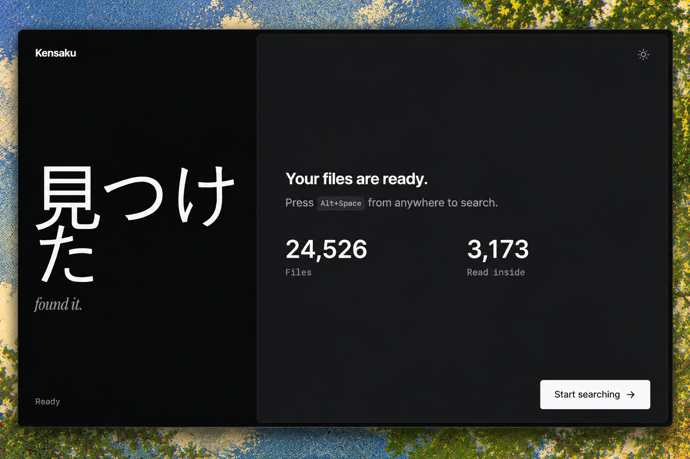

<p align="center">
  
</p>

<h1 align="center">Kensaku <span title="kensaku = search, in Japanese">検索</span></h1>

<p align="center">
  <b>Find anything on your computer, the way you remember it.</b>
</p>

<p align="center">
  <a href="https://upstar.dev/r/yjid/kensaku"><picture><source media="(prefers-color-scheme: dark)" srcset="https://upstar.dev/badge/yjid/kensaku/day/windows-dark.svg"></picture></a>
</p>

<p align="center">
  <a href="https://github.com/yjid/kensaku/releases/latest"></a>
  <a href="https://github.com/yjid/kensaku/releases/latest"></a>
  <a href="https://github.com/yjid/kensaku/stargazers"></a>
  <a href="LICENSE"></a>
  <a href="https://github.com/yjid/kensaku/actions/workflows/ci.yml"></a>
</p>

<p align="center">
  
</p>

---

You don't remember the filename. You remember what was inside.

- The PDF about database indexing, saved as `notes-final-2.pdf`.
- The log line from the failed deploy, somewhere in a folder of logs.
- The screenshot with a CUDA error, which has no useful name at all.

Type what you remember. Kensaku searches names, text inside files, and meaning, then highlights the match. Press Enter to open it.

Kensaku runs on Windows, macOS, and Linux. It's free, open source (MIT), and nothing leaves your machine.

## Try this

- `invoice ext:pdf modified:30d`
- `screenshots from last week`
- `the PDF about indexing`
- `timeout content:"connection reset"`

## Why it's different

Most file search tools only look at names. Kensaku also reads inside your files, locally and instantly.

| | Kensaku | Everything | Listary | PowerToys Run |
|---|:---:|:---:|:---:|:---:|
| Filename search | ✅ | ✅ | ✅ | ✅ |
| Text inside PDF, Word, EPUB and more | ✅ | ❌ | ❌ | ❌ |
| Text inside screenshots (OCR) | ✅ | ❌ | ❌ | ❌ |
| Chinese, Japanese, Korean text | ✅ | ❌ | ❌ | ❌ |
| Search by meaning | ✅ | ❌ | ❌ | ❌ |
| Your AI agents can search it (MCP) | ✅ | ❌ | ❌ | ❌ |

## Features

- **Fast.** About 100,000 files in a few milliseconds. Results update as you type.
- **Reads everything.** PDFs, Office files, email, ebooks, 50+ code and data formats, and text in images.
- **Understands you.** Typos are fine. Say "big videos from last month" or "last Tuesday" and it gets it.
- **A launcher that gets out of the way.** Keep it in the tray, summon it with a keystroke, and open with Enter. Prefer a normal window? Switch to desktop app mode in Settings.
- **Preview before you open.** Press Space to look at PDFs, images, and text.
- **Your AI agents get eyes.** Claude, Cursor, and other MCP clients can search your index. Read-only, local, no cloud.
- **Private.** No account, no telemetry, no cloud search. Your index stays on your computer.
- **Looks good.** Light and dark themes, in English, Simplified Chinese, and Russian.

<p align="center">
  
</p>

### Power user? Use the query language

```
type:pdf invoice       ext:md in:"~/Notes"     modified:7d
size:>10mb             path:"client/2026"      lang:rust
name:resume            content:"timeout"       -draft
```

Full reference: [docs/USAGE.md](docs/USAGE.md).

## Install

**Linux or macOS**

```bash
curl -fsSL https://github.com/yjid/kensaku/releases/latest/download/install.sh | sh
```

**Windows**

```powershell
powershell -ExecutionPolicy ByPass -c "irm https://github.com/yjid/kensaku/releases/latest/download/install.ps1 | iex"
```

Both install per user, so no admin prompt. Want to read the script first? Download it, check it, then run it with `--dry-run`. Manual downloads, system-wide installs, and uninstall steps are in [docs/INSTALL.md](docs/INSTALL.md).

**First run:** pick the folders to index, choose your exclusions, and pick launcher or desktop mode. Search works while the first scan runs.

**macOS note:** builds aren't notarized yet, so the first launch may need **System Settings → Privacy & Security → Open Anyway**.

### Build from source

```bash
git clone https://github.com/yjid/kensaku
cd kensaku
bun install
bun run tauri build
```

You'll need Rust (stable), Bun 1.1 or later, and your platform's webview libraries. Details are in [docs/INSTALL.md](docs/INSTALL.md).

## Command line and AI agents

`kensaku-cli` ships with every release.

```bash
kensaku-cli search "docker error"
kensaku-cli search "invoice" --ext pdf --since 30d
kensaku-cli search "resume" --json
```

To connect an MCP client, add this to its config:

```json
{
  "mcpServers": {
    "kensaku": { "command": "kensaku-cli", "args": ["mcp"] }
  }
}
```

Agents get read-only access and can't change your files. Guide: [docs/AGENTS.md](docs/AGENTS.md).

## Speed

On a 100,000-file index on Windows 11, a name search averages 18 ms, and about 3 ms with a tuned thread count. The in-memory file list for 100,000 files takes about 12 MB. Full method, hardware, and caveats are in [docs/BENCHMARKS.md](docs/BENCHMARKS.md).

## Privacy

- Search queries and file contents never leave your machine.
- The only outbound requests are update checks and optional OCR or model downloads.
- Hidden files, common build folders, and key files like `.pem` and `.key` are skipped by default.
- The index contains file names and extracted text, so don't sync it to a shared folder.

Full details: [docs/PRIVACY.md](docs/PRIVACY.md) and [SECURITY.md](SECURITY.md).

## Good to know

- Windows builds are code-signed. macOS builds aren't signed or notarized yet.
- Thumbnails are shown for images only. Documents and code show file-type icons.
- Windows gets the most real-world testing so far. macOS and Linux feedback is especially welcome.

Stuck on something? [docs/TROUBLESHOOTING.md](docs/TROUBLESHOOTING.md) and [docs/FAQ.md](docs/FAQ.md) cover the common ones.

## What's next

- **A glass theme and more customization.** [Vote](https://github.com/yjid/kensaku/discussions/36)
- **Launch apps too.** Type "term", open Terminal. [Vote](https://github.com/yjid/kensaku/discussions/37)
- **Optional internet search,** off by default and kept separate from local results. [Vote](https://github.com/yjid/kensaku/discussions/38)
- **macOS signing and notarization.** [Vote](https://github.com/yjid/kensaku/discussions/40)
- **Find similar images and related files.** [Vote](https://github.com/yjid/kensaku/discussions/39)

Ideas with real use cases get built first. Share yours in [Discussions](https://github.com/yjid/kensaku/discussions).

## Contributing

Kensaku is young and built by people who wanted a better launcher. Ways to help:

- **Break it.** Bug reports with steps to reproduce are the most useful thing you can send.
- **Add a format.** [docs/EXTRACTORS.md](docs/EXTRACTORS.md) shows how.
- **Improve search.** Ranking, typo handling, and translations.

For developers, the quick loop is `bun install`, `make dev`, and `make test`. The full guide is in [docs/CONTRIBUTING.md](docs/CONTRIBUTING.md). Found a security issue? Report it privately through [SECURITY.md](SECURITY.md).

If Kensaku saves you time, a star helps other people find it.

If Kensaku saves you time, a star helps other people find it.

<p align="center">
  <a href="https://github.com/yjid/kensaku/stargazers">⭐ Star Kensaku on GitHub</a>
</p>

## Star history

[](https://star-history.com/#yjid/kensaku&Date)
