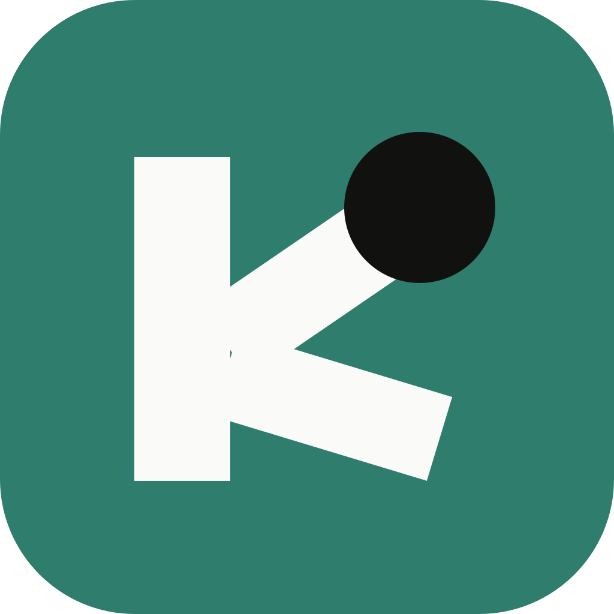
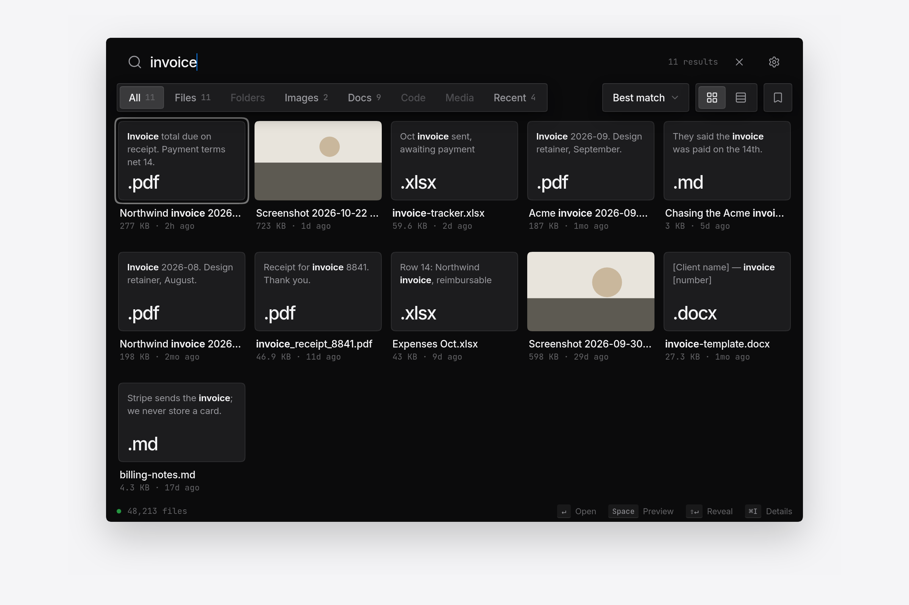
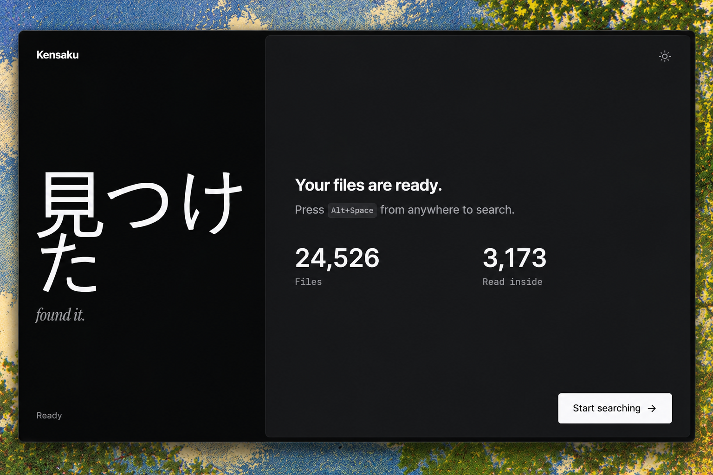

<p align="center">
  
</p>

<h1 align="center">Kensaku <span title="kensaku = search, in Japanese">検索</span></h1>

<p align="center">
  <b>Fast, light, and efficient. Find anything on your computer.</b>
</p>

<p align="center">
  Search 100,000 file names in milliseconds, with about 12 MB of metadata.<br/>
  Search inside documents, images, and code too. Nothing leaves your machine.
</p>

<p align="center">
  <a href="https://upstar.dev/r/yjid/kensaku"></a>
</p>

<p align="center">
  <a href="https://github.com/yjid/kensaku/releases/latest"></a>
  <a href="https://github.com/yjid/kensaku/releases/latest"></a>
  <a href="LICENSE"></a>
  <a href="https://github.com/yjid/kensaku/actions/workflows/ci.yml"></a>
</p>

<p align="center">
  <a href="#install">Install</a> ·
  <a href="#what-kensaku-does-that-the-others-dont">Why Kensaku</a> ·
  <a href="#features">Features</a> ·
  <a href="#performance">Performance</a> ·
  <a href="#connect-ai-agents-mcp">MCP</a> ·
  <a href="docs/README.md">Docs</a> ·
  <a href="docs/LANGUAGES.md">Languages</a> ·
  <a href="#contributing">Contribute</a>
</p>

<p align="center">
  
</p>

---

## Find it the way you remember it

You don't remember the filename. You remember what was in it.

- The PDF about database indexing, saved as `notes-final-2.pdf`.
- The log line from the failed deploy, somewhere in a folder of logs.
- The screenshot with a CUDA error, which has no useful name at all.

Type what you remember. Kensaku searches names, text inside files, and meaning, and shows the match with the words highlighted. Open it with Enter.

## What Kensaku does that the others don't

Filename tools are everywhere. Reading *inside* your files — locally, instantly, and for free — is not.

| | Kensaku | Everything | Listary | PowerToys Run |
|---|---|---|---|---|
| Filename search, milliseconds | ✅ | ✅ | ✅ | ✅ |
| Full text inside PDF/DOCX/EPUB… | ✅ | ❌ | ❌ | ❌ |
| Text inside screenshots & images (OCR) | ✅ | ❌ | ❌ | ❌ |
| Multilingual & CJK text (auto-tokenized) | ✅ | ❌ | ❌ | ❌ |
| Find by meaning ("the PDF about indexing") | ✅ | ❌ | ❌ | ❌ |
| Natural-language time ("screenshots from last week") | ✅ | ❌ | partial | ❌ |
| Your AI agents can search it (MCP) | ✅ | ❌ | ❌ | ❌ |
| Launcher behavior (summon, type, Enter) | ✅ | ❌ | ✅ | ✅ |
| Open source (MIT) | ✅ | ❌ | ❌ | ✅ |

*Spotlight and Raycast are excellent but macOS-only; Alfred's content search and AI are paid tiers. Kensaku is one app, three platforms, free and MIT-licensed.*

**Three things worth trying on day one:**

1. **Screenshot archaeology.** You know you saw that error in a screenshot. Kensaku read the pixels — search the error text.
2. **Describe, don't recall.** "big videos from last month" is a valid query. No filters to click.
3. **Give your AI agent eyes.** Claude or Cursor can search this same index over MCP — read-only, local, no cloud.

## Features

**Fast**
- Filename search across ~100,000 files in milliseconds on a warm cache. Method, hardware, and per-platform numbers are in [Performance](#performance).
- Results update as you type. There is no separate search page.
- Incremental indexing: changed files are picked up without rescanning the whole disk.
- Closing the window keeps the index warm; reopening is instant.

**Finds more**
- Names, full text, fuzzy matches that tolerate typos, and meaning, in one search.
- **Documents & Office**: PDF, DOCX, PPTX, XLSX, EPUB, ODT/ODS/ODP, RTF, CSV/TSV, and plain text.
- **Multilingual & CJK by default**: Custom unigram + bigram tokenizer for Chinese (Hanzi/Bopomofo), Japanese (Kanji/Kana), and Korean (Hangul), plus mixed-script boundary handling. Detailed breakdown in [docs/LANGUAGES.md](docs/LANGUAGES.md).
- **50+ Code & Data Formats**: Rust, Python, TypeScript, Go, C/C++, Java, Shell, SQL, JSON, YAML, TOML, Dockerfile, and more.
- **Images & OCR**: Text is read with PP-OCRv6 by default (bundled runtime; the ~6.1 MB model pack downloads once). Higher-quality Indra engine (deskew, multi-script Latin/CJK/RTL/World recognition, ~27 MB pack) and classic Tesseract are selectable in Setup/Settings.
- **Content depth you can tune**: up to 100 MB per file, 4 MB of text, and 48 semantic chunks by default; `quick` / `balanced` / `deep` presets.

**Precise**
- Filters and sort: Best match, Newest, Oldest, Largest, Name.
- Time travel: "last Tuesday", "3 days ago", "last week", "today", "yesterday".
- A query language when you want it (below).

**A real launcher**
- Starts in the tray and summons with a keystroke. Recents are ranked by what you actually opened, and they survive restarts.
- Or switch to **Desktop app** mode: a normal taskbar window. Launcher is the setup default; the desktop app is one click away in Setup or Settings.
- Space previews (Quick Look) for PDFs, images, and text. Grid or list layout. Full keyboard navigation. `Cmd/Ctrl+Shift+L` toggles the layout.

**Works with AI agents**
- Compatible agents can search the same local index over MCP. Read-only by default. See [Connect AI agents](#connect-ai-agents-mcp).
- Also: `find_symbol` for tree-sitter definitions, bounded regex search, scoped roots, and cursor pagination.

**Private**
- No account, no telemetry, no cloud search. Your index stays in your OS config directory.

**Pleasant to use**
- Light and dark themes. Continuous-corner cards, a borderless search field, and hover details — a calm, native-feeling interface.
- English, Simplified Chinese, and Russian interface, auto-detected from the system or chosen in Settings.
- Right-click for open, show in folder, copy path, and details.

<p align="center">
  
</p>

### The query language

For scripts and precise searches:

```
type:pdf invoice          ext:md in:"~/Notes"       modified:7d
size:>10mb                path:"client/2026"        lang:rust
name:resume               content:"timeout"         re:"fn \w+_test"
-draft                    mode:exhaustive
```

Full reference: [docs/USAGE.md](docs/USAGE.md) · Language & format support: [docs/LANGUAGES.md](docs/LANGUAGES.md).

## Install

Download the bundle for your system from the [latest release](https://github.com/yjid/kensaku/releases/latest).

| Platform | Download |
|---|---|
| Windows (Intel/AMD) | `kensaku_<version>_x64-setup.exe` or `kensaku_<version>_x64_en-US.msi` |
| Windows (ARM, Snapdragon) | `kensaku_<version>_arm64-setup.exe` or `kensaku_<version>_arm64_en-US.msi` |
| Windows portable | `kensaku-portable-<version>-x64.zip` (or `-arm64.zip`) |
| macOS (Apple silicon and Intel) | `kensaku_<version>_universal.dmg` |
| Linux | `kensaku_<version>_amd64.AppImage`, `.deb`, or `.rpm` |
| Agent CLI | `kensaku-cli-{linux,macos,windows}-*` |

Every release also ships `SHA256SUMS` so you can verify what you downloaded. The 1.0.16 Windows x64 downloads are a **14.3 MB** NSIS setup and a **20.1 MB** MSI; the installed app binary is about **36 MB**.

Builds are not yet code-signed, so macOS and Windows show a warning the first time. That is expected for an independent app, not a sign of a problem.

- **Windows:** on the SmartScreen prompt, click **More info** → **Run anyway**.
- **macOS:** open the app, then go to System Settings → Privacy & Security and click **Open Anyway**.

[docs/INSTALL.md](docs/INSTALL.md) has the full steps.

**First run:** choose the folders you want indexed, pick exclusions, choose launcher or desktop mode, and optionally download the OCR or model packs. Search works while the first scan runs. Closing the window keeps Kensaku running in the tray; quit from the tray.

**Command line:** `kensaku-cli` ships with each release.

```bash
kensaku-cli search "docker error"
kensaku-cli search "invoice" --ext pdf --since 30d
kensaku-cli search "resume" --json
kensaku-cli state
kensaku-cli mcp
kensaku-cli serve --port 8765
```

### Build from source

```bash
git clone https://github.com/yjid/kensaku
cd kensaku
bun install
bun run tauri build
```

You need Rust (stable), Bun 1.1 or later, and your platform's webview libraries. See [docs/INSTALL.md](docs/INSTALL.md). A `Makefile` covers the common tasks: `make dev`, `make build`, `make test`, and `make reset`.

## Connect AI agents (MCP)

Point an MCP client at the CLI:

```json
{
  "mcpServers": {
    "kensaku": { "command": "kensaku-cli", "args": ["mcp"] }
  }
}
```

For clients that connect over HTTP, run `kensaku-cli serve`. It listens on loopback only and requires a bearer token stored in your config directory.

Responses are budgeted in size, and file content is returned as data, never as instructions. Full guide: [docs/AGENTS.md](docs/AGENTS.md).

## Performance

Speed is the point of Kensaku. Every number below was measured; the full method, corpus, hardware, and caveats are in [docs/BENCHMARKS.md](docs/BENCHMARKS.md).

| What | Result |
|---|---|
| Name search, 100k files (Windows 11, 1.0.16, default threads) | **18 ms average** (best 8.3 ms) |
| Name search, 100k files (Windows 11, 4 threads) | **3.1 ms average** |
| Name search, 100k files (Linux reference, warm) | **1.3 ms average** (best 0.5 ms) |
| Metadata for 100k files | **12.2 MB** (128 B per entry) |
| First run over 101k mixed files (earlier Linux reference) | 184 s, peak 183 MB |
| Re-index with nothing changed (same corpus) | 0.56 s |

The Windows and Linux rows are the same workload on different machines, not a
regression: Windows NTFS metadata reads and antivirus make the walk much slower,
and a 16-thread rayon pool adds scheduling overhead to a scan that the
char-bloom prefilter already makes cheap. On the same 100k corpus, 4–8 threads
average 3–5 ms. The Linux number is the historical warm-cache reference. Neither
is a cross-platform "fastest" claim.

Same folder class, filename search, cold process each run (Linux reference):

| Tool | "invoice" | "deploy_error" |
|---|---|---|
| Kensaku (in memory, no start-up) | 1.3 ms avg | 1.3 ms avg |
| plocate | 34 ms | 6 ms |
| fd | 109 ms | 98 ms |

The two rows aren't a perfect match: Kensaku's search is fuzzy and runs inside a running app, while plocate and fd start a new program for each search. Spotlight, Everything, and Listary haven't been measured, and these numbers come from Linux, not macOS or Windows.

**Memory.** The in-memory metadata layer is 128 bytes per `FileEntry`: 12.2 MB for 100,201 entries. The index itself, Tantivy, and the optional embedding table are separate. On Windows, closing the window destroys the webview and keeps the Rust index warm, so the idle footprint is the index rather than a full UI.

Indexing is a single pass: each file is read once and feeds both the name and text indexes. Work is queued in bounded batches, so memory stays flat on large folders.

## What's new in 1.0.16

- **Launcher fix:** right-click and the sort control no longer make the launcher hide itself; the context menu is suppressed and sort is an in-app listbox.
- **Clean installs no longer report a crash** on startup; milestones go to `kensaku.log` and only real failures reach the crash log.
- **Windows portable OCR works** — `onnxruntime.dll` now ships in the zip and the build fails if it is missing.
- **Tesseract reads the languages you have** — `-l` is passed, and Settings → Search has a language picker.
- **Folder renames and unreadable folders are handled correctly** instead of leaving stale documents or deleting a subtree.
- **`.gitignore` / `.cursorignore` are honored by the watcher**, not just the crawl.
- **Indexing recovers from a panic**, excluded extensions are removed from the existing index, and files over 1 MB honor the deep-content setting.
- **Updates are bounded and verified**: timeout, expected size, and `SHA256SUMS` check before install; truncated downloads are rejected.
- **MCP `read_snippet` can no longer read arbitrary files** outside the index; credential files and excluded extensions are refused.
- **IME Enter no longer opens files**, Tab no longer traps focus, and actions no longer apply to the previous query's rows.
- Frontend unit tests (`vitest`) and an indexing progress bar in Settings.

## Privacy and security

- **Local by default.** No telemetry, no account, no cloud search. Search queries and file contents never leave your machine; the only outbound requests are an update check and model/OCR downloads.
- **You choose what is indexed.** Watched folders and exclusions are yours. Hidden files and common build folders are skipped by default, and credential files such as `.pem`, `.key`, and `.pfx` are excluded.
- **Bounded processing.** Each file has a time limit and a size limit, so one bad file can't stall the index.
- **Read-only agent access.** The agent tools cannot change files. `reindex` is off unless you enable it.
- **Treat the index as sensitive.** It contains file names and extracted text. Don't sync it to a shared location.

Full threat model: [SECURITY.md](SECURITY.md).

## Status

**Shipping now (1.0.16)**

- Desktop app for Windows, macOS, and Linux: light and dark themes, grid and list results, infinite scroll, thumbnails, hover details, right-click actions
- Two window modes: a tray launcher with a global summon keystroke (setup default) or a normal desktop app; closing either keeps the index warm
- English, Simplified Chinese, and Russian interface, auto-detected from the system or chosen in Settings
- Recents ranked by what you actually opened, persisted across restarts
- Search by name, content, meaning, and typo-tolerant matches
- Documents, code, and images (with OCR), CJK-aware
- Incremental indexing that tracks renames and deletes
- Agent access over MCP and loopback HTTP, with one-click setup for Claude and Cursor
- `.gitignore` and `.cursorignore` respected by default
- In-app updates: background checks, release notes, progress, size + checksum verification, and one-click install

**Known limitations**

- Builds are not yet code-signed. In-app updating works, but macOS and Windows still warn on first install.
- OCR: PP-OCRv6 by default (bundled runtime, ~6.1 MB model pack); optional Indra engine with deskew and multi-script recognition (~27 MB pack). Intel Macs fall back to Tesseract. JPEG 2000, fax, and JBIG2 scans are not decoded yet.
- Thumbnails cover image files only. Documents and code show type icons.
- Visual search is a beta model download and is not part of search results yet.
- Windows gets the most real-world testing today. macOS and Linux builds ship from CI and would benefit from more hands on them — see below.

## What might come next

Kensaku is actively built, and the roadmap bends toward what people ask for. Some directions being explored:

- **A glass theme — and more customization.** A translucent, vibrancy-style finish, with adjustable density, accents, and per-surface control. The current light/dark pair is the floor, not the ceiling. → [vote & discuss](https://github.com/yjid/kensaku/discussions/36)
- **App search and launch.** Type "term", open Terminal. Installed applications join the same instant index, so the launcher stops where your files end and your tools begin. → [vote & discuss](https://github.com/yjid/kensaku/discussions/37)
- **Internet quick search.** For the things your files can't answer — opt-in, off by default, clearly separated from local results so the local-first promise stays intact. → [vote & discuss](https://github.com/yjid/kensaku/discussions/38)
- **Signed builds and notarization.** In-app updates ship now; a paid signing identity is the missing piece for a warning-free first install. → [vote & discuss](https://github.com/yjid/kensaku/discussions/40)
- **Visual and related-file agents.** Text-to-image and similar-image lookup once a real visual encoder is wired into search; `find_related` for same-stem/import/neighbour lookups. → [vote & discuss](https://github.com/yjid/kensaku/discussions/39)

None of this ships on a promise — it ships in the order the community pushes. **You tell us:** open a [discussion](https://github.com/yjid/kensaku/discussions) with your use case, or upvote an existing idea in the [issue tracker](https://github.com/yjid/kensaku/issues). The loudest real-world need gets the next slot.

## Contributing

Kensaku is young, MIT-licensed, and built by people who wanted a better launcher. Every kind of help moves it forward:

- **Use it and break it.** Bug reports with steps to reproduce are the single most valuable contribution right now — especially from macOS and Linux users.
- **Shape the roadmap.** Feature ideas land in [Discussions](https://github.com/yjid/kensaku/discussions); the ones with real use cases behind them get built first.
- **Good first issues.** Check the [issue tracker](https://github.com/yjid/kensaku/issues) for tasks scoped for a first contribution.
- **Search quality.** Ranking, typo tolerance, and new extractors ([docs/EXTRACTORS.md](docs/EXTRACTORS.md) shows how to add one).
- **Agents and integrations.** MCP tooling and guides ([docs/AGENTS.md](docs/AGENTS.md)).
- **Docs, translations, and screenshots.** [docs/CONTRIBUTING.md](docs/CONTRIBUTING.md) has the setup: `bun install`, `make dev`, `make test` (500+ Rust tests plus the frontend vitest suite run on every push).
- **Security.** Please report vulnerabilities privately via [SECURITY.md](SECURITY.md).

If Kensaku saves you ten minutes, [star the repository](https://github.com/yjid/kensaku/stargazers) — it's the only marketing an independent app has, and it's how the next contributor finds us.


## Star history

[](https://star-history.com/#yjid/kensaku&Date)
